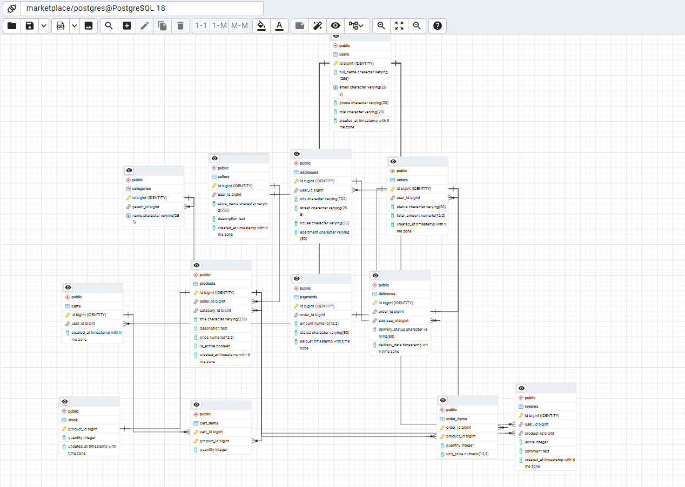

# Отчёт по лабораторной работе №1
**Дисциплина:** Математические основы баз данных
**Тема:** Проектирование реляционной схемы базы данных для маркетплейса

---

## 1. Цель работы

Изучение теоретических основ проектирования реляционных баз данных, освоение принципов нормализации отношений до 3-й нормальной формы (3НФ), разработка концептуальной и логической схемы базы данных для предметной области «Маркетплейс» и её физическая реализация в СУБД PostgreSQL.

---

## 2. Описание предметной области

Предметная область — электронная торговая площадка (маркетплейс), связывающая покупателей и продавцов. Система должна обеспечивать выполнение следующих функций:

* Управление пользователями и их ролями (покупатели, продавцы);
* Ведение каталога товаров, распределенных по категориям;
* Управление профилями магазинов (продавцов);
* Организация корзины товаров для покупателей;
* Оформление и обработка заказов, а также учет позиций заказа;
* Фиксация платежей и статусов доставки;
* Учет остатков товаров на складе;
* Сбор отзывов и оценок покупателей на товары.

---

## 3. Логическое проектирование и нормализация (3НФ)

В результате анализа предметной области выделено **13 сущностей**. Схема базы данных приведена к третьей нормальной форме (3НФ):

1. **1НФ:** Все атрибуты атомарны, у таблиц определены первичные ключи.
2. **2НФ:** Все неключевые атрибуты функционально полно зависят от первичного ключа. Связи «многие-ко-многим» (товары в заказах и корзинах) развязаны через промежуточные таблицы (`order_items`, `cart_items`).
3. **3НФ:** Транзитивные зависимости между неключевыми атрибутами отсутствуют.

### Список таблиц и их назначение

* `users` — учетные записи пользователей системы;
* `sellers` — профили продавцов/магазинов (связь 1:1 с `users`, `UNIQUE(user_id)`);
* `addresses` — адреса доставки пользователей;
* `categories` — плоский справочник категорий товаров;
* `products` — каталог товаров;
* `stock` — учет количества товара на складе (связь 1:1 с `products`, PK по `product_id`);
* `carts` — корзины покупателей (связь 1:1 с `users`, `UNIQUE(user_id)`);
* `cart_items` — товары в корзине (N:M между `carts` и `products`, PK `(cart_id, product_id)`);
* `orders` — оформленные заказы;
* `order_items` — состав заказа с фиксацией цены на момент покупки (`unit_price`, PK `(order_id, product_id)`);
* `payments` — данные об оплате заказов (связь 1:1 с `orders`, `UNIQUE(order_id)`);
* `deliveries` — сведения о доставке заказов (связь 1:1 с `orders`, `UNIQUE(order_id)`, привязка к `addresses`);
* `reviews` — отзывы покупателей на товары (один отзыв пользователя на товар, `UNIQUE(user_id, product_id)`).

---

## 4. ER-диаграмма

Физическая схема базы данных, сгенерированная в pgAdmin 4:



---

## 5. Физическая реализация (DDL-скрипт)

База данных реализована в **PostgreSQL 18.6**. Полный скрипт — в файле [`01_schema.sql`](./01_schema.sql): транзакционный (`BEGIN; ... END;`), идемпотентный (`CREATE TABLE IF NOT EXISTS`, `ALTER TABLE IF EXISTS`), PK на `bigserial`, деньги — `numeric(12,2)`, целостность — `FOREIGN KEY`. Ниже — ключевые фрагменты из реального скрипта:

```sql
CREATE TABLE users (
    id BIGINT GENERATED ALWAYS AS IDENTITY PRIMARY KEY,
    full_name VARCHAR(255) NOT NULL,
    email VARCHAR(255) NOT NULL UNIQUE,
    phone VARCHAR(20),
    role VARCHAR(20) NOT NULL DEFAULT 'customer', 
    created_at TIMESTAMP WITH TIME ZONE DEFAULT now()
);

CREATE TABLE sellers (
    id BIGINT GENERATED ALWAYS AS IDENTITY PRIMARY KEY,
    user_id BIGINT NOT NULL UNIQUE REFERENCES users(id) ON DELETE CASCADE,
    store_name VARCHAR(255) NOT NULL,
    description TEXT,
    created_at TIMESTAMP WITH TIME ZONE DEFAULT now()
);

CREATE TABLE categories (
    id BIGINT GENERATED ALWAYS AS IDENTITY PRIMARY KEY,
    parent_id BIGINT REFERENCES categories(id) ON DELETE RESTRICT,
    name VARCHAR(255) NOT NULL UNIQUE
);

CREATE TABLE products (
    id BIGINT GENERATED ALWAYS AS IDENTITY PRIMARY KEY,
    seller_id BIGINT NOT NULL REFERENCES sellers(id) ON DELETE RESTRICT,
    category_id BIGINT NOT NULL REFERENCES categories(id) ON DELETE RESTRICT,
    title VARCHAR(255) NOT NULL,
    description TEXT,
    price NUMERIC(12, 2) NOT NULL CHECK (price > 0),
    is_active BOOLEAN NOT NULL DEFAULT TRUE,
    created_at TIMESTAMP WITH TIME ZONE DEFAULT now()
);

CREATE TABLE stock (
    product_id BIGINT PRIMARY KEY REFERENCES products(id) ON DELETE CASCADE,
    quantity INTEGER NOT NULL DEFAULT 0 CHECK (quantity >= 0),
    updated_at TIMESTAMP WITH TIME ZONE DEFAULT now()
);

CREATE TABLE carts (
    id BIGINT GENERATED ALWAYS AS IDENTITY PRIMARY KEY,
    user_id BIGINT NOT NULL REFERENCES users(id) ON DELETE CASCADE,
    created_at TIMESTAMP WITH TIME ZONE DEFAULT now()
);

CREATE TABLE cart_items (
    cart_id BIGINT NOT NULL REFERENCES carts(id) ON DELETE CASCADE,
    product_id BIGINT NOT NULL REFERENCES products(id) ON DELETE CASCADE,
    quantity INTEGER NOT NULL CHECK (quantity > 0),
    PRIMARY KEY (cart_id, product_id)
);

CREATE TABLE orders (
    id BIGINT GENERATED ALWAYS AS IDENTITY PRIMARY KEY,
    user_id BIGINT NOT NULL REFERENCES users(id) ON DELETE RESTRICT,
    status VARCHAR(50) NOT NULL DEFAULT 'created',
    total_amount NUMERIC(12, 2) NOT NULL DEFAULT 0,
    created_at TIMESTAMP WITH TIME ZONE DEFAULT now()
);

CREATE TABLE order_items (
    order_id BIGINT NOT NULL REFERENCES orders(id) ON DELETE CASCADE,
    product_id BIGINT NOT NULL REFERENCES products(id) ON DELETE RESTRICT,
    quantity INTEGER NOT NULL CHECK (quantity > 0),
    unit_price NUMERIC(12, 2) NOT NULL CHECK (unit_price > 0),
    PRIMARY KEY (order_id, product_id)
);

CREATE TABLE payments (
    id BIGINT GENERATED ALWAYS AS IDENTITY PRIMARY KEY,
    order_id BIGINT NOT NULL UNIQUE REFERENCES orders(id) ON DELETE CASCADE,
    amount NUMERIC(12, 2) NOT NULL CHECK (amount > 0),
    status VARCHAR(50) NOT NULL DEFAULT 'pending',
    paid_at TIMESTAMP WITH TIME ZONE
);

CREATE TABLE reviews (
    id BIGINT GENERATED ALWAYS AS IDENTITY PRIMARY KEY,
    user_id BIGINT NOT NULL REFERENCES users(id) ON DELETE CASCADE,
    product_id BIGINT NOT NULL REFERENCES products(id) ON DELETE CASCADE,
    score INTEGER NOT NULL CHECK (score BETWEEN 1 AND 5),
    comment TEXT,
    created_at TIMESTAMP WITH TIME ZONE DEFAULT now()
);

CREATE TABLE addresses (
    id BIGINT GENERATED ALWAYS AS IDENTITY PRIMARY KEY,
    user_id BIGINT NOT NULL REFERENCES users(id) ON DELETE CASCADE,
    city VARCHAR(100) NOT NULL,
    street VARCHAR(255) NOT NULL,
    house VARCHAR(50) NOT NULL,
    apartment VARCHAR(50)
);
CREATE TABLE deliveries (
    id BIGINT GENERATED ALWAYS AS IDENTITY PRIMARY KEY,
    order_id BIGINT NOT NULL UNIQUE REFERENCES orders(id) ON DELETE CASCADE,
    address_id BIGINT NOT NULL REFERENCES addresses(id) ON DELETE RESTRICT,
    delivery_status VARCHAR(50) NOT NULL DEFAULT 'pending',
    delivery_date TIMESTAMP WITH TIME ZONE
);
```

Остальные таблицы (`addresses`, `carts`, `cart_items`, `payments`, `deliveries`, `reviews`) и все внешние ключи (`ON DELETE CASCADE / RESTRICT / NO ACTION` — см. `ALTER TABLE ... ADD CONSTRAINT` в конце скрипта) — в полном файле [`01_schema.sql`](./01_schema.sql).

Запуск:

```bash
psql -U postgres -d marketplace -f lab_1/01_schema.sql
```

---

## 6. Вывод

В ходе выполнения лабораторной работы №1 была полностью спроектирована реляционная база данных для маркетплейса. Были построены концептуальная, логическая и физическая модели данных, проведена нормализация до 3НФ, а также сформирован и успешно выполнен DDL-скрипт создания структуры в PostgreSQL.